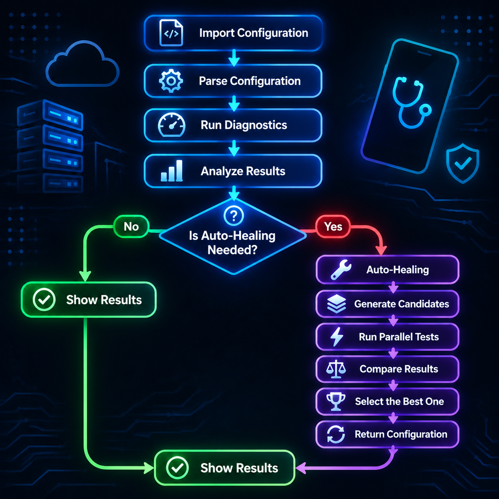
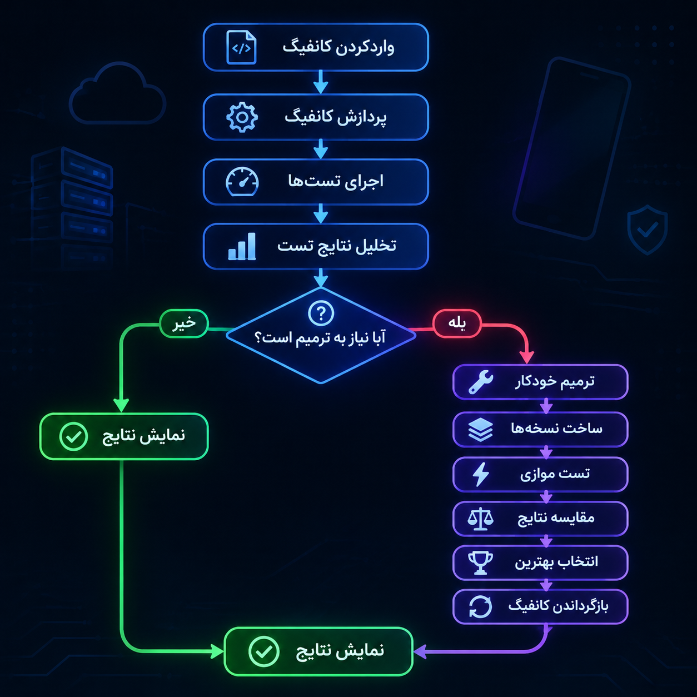

# Config Doctor

<p align="center">
  
</p>

<p align="center">
  <b>Your Configurations Deserve Better.</b>
</p>

<p align="center">
  Diagnose, analyze, and heal your proxy configurations with ease.
</p>

<p align="center">
  <a href="#english">English</a> •
  <a href="#فارسی">فارسی</a>
</p>

<p align="center">
  <a href="https://github.com/Mpyj/ConfigDoctor/releases">
    
  </a>
  <a href="https://github.com/Mpyj/ConfigDoctor">
    
  </a>
  <a href="LICENSE">
    
  </a>
  
  
</p>

---

# English

<a id="english"></a>

## Introduction

Tired of unstable proxy configurations, confusing connection tests, and manually searching for better IPs?

**Config Doctor** is an Android application designed to diagnose, analyze, and automatically improve proxy configurations.

Instead of relying on a single connectivity test, Config Doctor performs multiple diagnostic checks to help identify connection problems and provides an Auto-Healing system that can generate and test alternative Cloudflare IP configurations.

Whether you want to understand why a configuration is not working or find a better-performing alternative, Config Doctor helps make the process easier.

## Features

### Smart Diagnosis

A multi-stage diagnostic system that evaluates different aspects of a configuration:

- **TCP Test:** Checks TCP connectivity.
- **TLS Test:** Evaluates TLS connectivity.
- **Real Delay:** Measures real connection delay using the Xray-based core.
- **Packet Loss:** Evaluates packet loss.
- **Jitter:** Measures variations in network delay.

### Auto-Healing

Automatically generates and evaluates alternative configurations using Cloudflare IP addresses.

The process includes:

1. Generating alternative configuration versions.
2. Testing multiple versions in parallel.
3. Comparing diagnostic results.
4. Selecting the best-performing result.
5. Returning the improved configuration.

> Currently, Auto-Healing uses Cloudflare IP addresses. Additional sources and methods may be introduced in future versions.

### Other Features

- Import configurations through subscription links.
- Scan configuration QR codes.
- View previous diagnostic results through History.
- Dark and Light themes.
- Automatic theme switching based on time.
- Persian and English language support.
- Right-to-left and left-to-right layouts.

## Supported Protocols

- VLESS
- VMess
- Trojan

## How It Works

The following diagram illustrates the diagnostic and Auto-Healing workflow.

<p align="center">
  
</p>

## Works Alongside Your Favorite Clients

Config Doctor is designed to complement proxy clients such as:

- v2rayNG
- PattNG

These applications handle connections, while Config Doctor focuses on configuration diagnosis, analysis, and improvement.

**Config Doctor is not a replacement for your proxy client.**

## Privacy

Configuration processing and diagnostic operations are performed locally on your device.

Config Doctor does not require you to upload your configuration to a remote server for its core diagnostic and Auto-Healing workflow.

Network tests naturally communicate with their respective destination endpoints.

Always review the configurations and endpoints you choose to use.

## Technology Stack

| Technology | Purpose |
|---|---|
| Kotlin 2.0.21 | Main programming language |
| Jetpack Compose | UI development |
| Material 3 | UI components |
| MVVM | Application architecture |
| Room | Local database |
| DataStore | Preferences storage |
| CameraX | Camera integration |
| Google ML Kit | QR code scanning |
| Java Networking APIs | TCP and HTTP operations |
| AndroidLibXrayLite | Xray-based core integration |
| GitHub Actions | Build automation |

## Project Structure

```text
app/src/main/java/com/configdoctor/
├── data/
├── diagnose/
│   ├── Diagnostician.kt
│   ├── TcpTester.kt
│   ├── TlsTester.kt
│   ├── PacketLossTester.kt
│   ├── XrayRealDelayTester.kt
│   └── CloudflareCleanIps.kt
├── model/
├── parser/
├── ui/
│   ├── components/
│   └── screens/
└── MainActivity.kt
```

## Download

Get the latest version from the GitHub Releases page.

**[Download Config Doctor](https://github.com/Mpyj/ConfigDoctor/releases)**

Available release packages may include:

- `app-arm64-v8a-release.apk`
- `app-armeabi-v7a-release.apk`
- `app-universal-release.apk`

Choose the package appropriate for your device. The Universal APK is a broadly packaged option, but compatibility may still depend on your Android version and device.

## Build from Source

### Requirements

- Android Studio
- JDK compatible with the project
- Android SDK
- Gradle Wrapper

### Clone the Repository

```bash
git clone https://github.com/Mpyj/ConfigDoctor.git
cd ConfigDoctor
```

### Build

On Linux and macOS:

```bash
./gradlew assembleDebug
```

On Windows:

```powershell
.\gradlew.bat assembleDebug
```

The debug APK will be generated in:

```text
app/build/outputs/apk/debug/
```

## Roadmap

- [x] Smart Diagnosis
- [x] Auto-Healing with Cloudflare IPs
- [x] Subscription Import
- [x] QR Code Scanner
- [x] Diagnostic History
- [x] Persian and English Support
- [ ] Additional Auto-Healing sources
- [ ] More diagnostic improvements
- [ ] Further UI and performance enhancements

## Contributing

Contributions, bug reports, and suggestions are welcome.

If you find a bug or have an idea for improving Config Doctor, feel free to open an issue.

- [Report a Bug](https://github.com/Mpyj/ConfigDoctor/issues)
- [Browse the Repository](https://github.com/Mpyj/ConfigDoctor)

## License

Config Doctor is distributed under the **Mpyj Attribution License v1.0**.

You are permitted to use, study, modify, and redistribute the project under the conditions specified in the [LICENSE](LICENSE) file.

Attribution to **Mpyj** and **Config Doctor** is required.

This is a custom attribution-based license and is not an OSI-approved Open Source License.

---

# فارسی

<a id="فارسی"></a>

<p align="center">
  
</p>

<p align="center">
  <b>کانفیگ‌های شما شایسته بهترین‌ها هستند.</b>
</p>

<p align="center">
  عیب‌یابی، تحلیل و ترمیم کانفیگ‌های پراکسی به ساده‌ترین شکل ممکن.
</p>

<p align="center">
  <a href="#english">English</a> •
  <a href="#فارسی">فارسی</a>
</p>

## معرفی

تا حالا کار با کانفیگ‌های ناپایدار، تست اتصال و پیدا کردن IPهای بهتر برات سخت بوده؟

**دکتر کانفیگ (Config Doctor)** یک اپلیکیشن اندرویدی برای عیب‌یابی، تحلیل و بهبود خودکار کانفیگ‌های پراکسی است.

این برنامه به‌جای تکیه بر یک تست ساده اتصال، چندین مرحله عیب‌یابی را اجرا می‌کند تا مشکلات احتمالی کانفیگ را شناسایی کند.

همچنین با استفاده از سیستم **Auto-Healing** می‌تواند نسخه‌های جایگزین مبتنی بر IPهای Cloudflare ایجاد و آن‌ها را آزمایش کند تا بهترین نتیجه را انتخاب کند.

چه بخواهی دلیل کار نکردن یک کانفیگ را پیدا کنی و چه بخواهی جایگزین بهتری برای آن داشته باشی، دکتر کانفیگ این فرایند را ساده‌تر می‌کند.

## قابلیت‌ها

### عیب‌یابی هوشمند (Smart Diagnosis)

سیستم عیب‌یابی چندمرحله‌ای برای بررسی بخش‌های مختلف اتصال:

- **TCP Test:** بررسی برقراری اتصال TCP.
- **TLS Test:** بررسی وضعیت اتصال TLS.
- **Real Delay:** اندازه‌گیری تأخیر واقعی اتصال با استفاده از هسته مبتنی بر Xray.
- **Packet Loss:** بررسی میزان ازدست‌رفتن بسته‌های شبکه.
- **Jitter:** اندازه‌گیری نوسانات تأخیر شبکه.

### ترمیم خودکار (Auto-Healing)

این قابلیت با استفاده از IPهای جایگزین Cloudflare، نسخه‌های مختلفی از کانفیگ ایجاد و عملکرد آن‌ها را بررسی می‌کند.

مراحل کار:

1. تولید نسخه‌های جایگزین کانفیگ.
2. آزمایش هم‌زمان نسخه‌های مختلف.
3. مقایسه نتایج عیب‌یابی.
4. انتخاب نسخه با بهترین عملکرد.
5. بازگرداندن کانفیگ بهبودیافته.

> در نسخه فعلی، سیستم Auto-Healing از IPهای Cloudflare استفاده می‌کند. منابع و روش‌های بیشتری ممکن است در نسخه‌های آینده اضافه شوند.

### سایر امکانات

- واردکردن کانفیگ از طریق لینک Subscription.
- اسکن QR Code کانفیگ‌ها.
- مشاهده نتایج تست‌های قبلی در بخش History.
- پوسته روشن و تاریک.
- تغییر خودکار پوسته بر اساس زمان.
- پشتیبانی از زبان فارسی و انگلیسی.
- پشتیبانی از چیدمان راست‌چین و چپ‌چین.

## پروتکل‌های پشتیبانی‌شده

- VLESS
- VMess
- Trojan

## نحوه عملکرد

نمودار زیر فرایند عیب‌یابی و ترمیم خودکار در دکتر کانفیگ را نمایش می‌دهد.

<p align="center">
  
</p>

## مکمل کلاینت‌های پراکسی

دکتر کانفیگ در کنار کلاینت‌هایی مانند موارد زیر قابل استفاده است:

- v2rayNG
- PattNG

این برنامه‌ها وظیفه مدیریت اتصال را بر عهده دارند؛ درحالی‌که دکتر کانفیگ روی عیب‌یابی، تحلیل و بهبود کانفیگ تمرکز می‌کند.

**دکتر کانفیگ جایگزین کلاینت پراکسی شما نیست؛ بلکه مکمل آن است.**

## حریم خصوصی

پردازش کانفیگ‌ها و عملیات عیب‌یابی در خود دستگاه شما انجام می‌شوند.

برای اجرای فرایند اصلی عیب‌یابی و Auto-Healing نیازی به بارگذاری کانفیگ روی سرور راه دور نیست.

البته تست‌های شبکه طبیعتاً با مقصدهای مربوط به خود ارتباط برقرار می‌کنند.

همیشه کانفیگ‌ها و مقصدهایی را که برای اتصال انتخاب می‌کنید بررسی کنید.

## فناوری‌های استفاده‌شده

| فناوری | کاربرد |
|---|---|
| Kotlin 2.0.21 | زبان اصلی برنامه‌نویسی |
| Jetpack Compose | توسعه رابط کاربری |
| Material 3 | کامپوننت‌های رابط کاربری |
| MVVM | معماری برنامه |
| Room | پایگاه داده محلی |
| DataStore | ذخیره تنظیمات |
| CameraX | دسترسی به دوربین |
| Google ML Kit | اسکن QR Code |
| Java Networking APIs | عملیات TCP و HTTP |
| AndroidLibXrayLite | یکپارچه‌سازی هسته مبتنی بر Xray |
| GitHub Actions | خودکارسازی فرایند Build |

## ساختار پروژه

```text
app/src/main/java/com/configdoctor/
├── data/
├── diagnose/
│   ├── Diagnostician.kt
│   ├── TcpTester.kt
│   ├── TlsTester.kt
│   ├── PacketLossTester.kt
│   ├── XrayRealDelayTester.kt
│   └── CloudflareCleanIps.kt
├── model/
├── parser/
├── ui/
│   ├── components/
│   └── screens/
└── MainActivity.kt
```

## دانلود

برای دریافت آخرین نسخه دکتر کانفیگ به صفحه Releases گیت‌هاب مراجعه کنید.

**[دانلود دکتر کانفیگ](https://github.com/Mpyj/ConfigDoctor/releases)**

نسخه‌های منتشرشده ممکن است شامل فایل‌های زیر باشند:

- `app-arm64-v8a-release.apk`
- `app-armeabi-v7a-release.apk`
- `app-universal-release.apk`

با توجه به دستگاه خود نسخه مناسب را انتخاب کنید. نسخه Universal بسته‌ای با پوشش گسترده‌تر است، اما سازگاری نهایی همچنان به نسخه اندروید و دستگاه شما بستگی دارد.

## ساخت از سورس

### پیش‌نیازها

- Android Studio
- نسخه سازگار JDK با پروژه
- Android SDK
- Gradle Wrapper

### دریافت پروژه

```bash
git clone https://github.com/Mpyj/ConfigDoctor.git
cd ConfigDoctor
```

### ساخت برنامه

در Linux و macOS:

```bash
./gradlew assembleDebug
```

در Windows:

```powershell
.\gradlew.bat assembleDebug
```

فایل APK نسخه Debug در مسیر زیر ساخته می‌شود:

```text
app/build/outputs/apk/debug/
```

## نقشه راه

- [x] عیب‌یابی هوشمند
- [x] ترمیم خودکار با IPهای Cloudflare
- [x] واردکردن Subscription
- [x] اسکن QR Code
- [x] تاریخچه نتایج عیب‌یابی
- [x] پشتیبانی از فارسی و انگلیسی
- [ ] اضافه‌کردن منابع بیشتر برای Auto-Healing
- [ ] بهبود قابلیت‌های عیب‌یابی
- [ ] بهبودهای بیشتر در رابط کاربری و عملکرد

## مشارکت در پروژه

از مشارکت‌ها، گزارش باگ‌ها و پیشنهادهای شما استقبال می‌کنیم.

اگر مشکلی در برنامه پیدا کردید یا ایده‌ای برای بهتر شدن آن دارید، می‌توانید یک Issue در گیت‌هاب ثبت کنید.

- [گزارش مشکل](https://github.com/Mpyj/ConfigDoctor/issues)
- [مشاهده مخزن پروژه](https://github.com/Mpyj/ConfigDoctor)

## مجوز استفاده

دکتر کانفیگ تحت مجوز **Mpyj Attribution License v1.0** منتشر می‌شود.

استفاده، مطالعه، تغییر و بازنشر پروژه طبق شرایط مشخص‌شده در فایل [LICENSE](LICENSE) مجاز است.

ذکر نام **Mpyj** و **Config Doctor** الزامی است.

این مجوز یک مجوز سفارشی مبتنی بر الزام انتساب نام است و در دسته مجوزهای Open Source تأییدشده توسط OSI قرار نمی‌گیرد.

---

<p align="center">
  Made with ❤️ by <a href="https://github.com/Mpyj">Mpyj</a>
</p>

<p align="center">
  <a href="https://t.me/MpyjTelegram">Telegram</a> •
  <a href="https://x.com/Mpyj_X">X</a> •
  <a href="https://github.com/Mpyj">GitHub</a>
</p>

<p align="center">
  More to come.
</p>